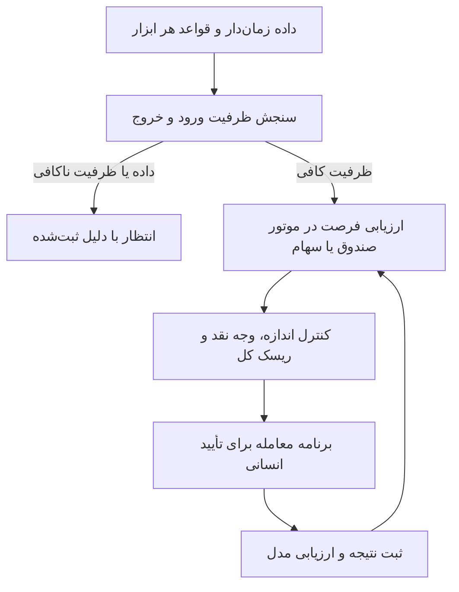

# خط فکری توسعه تصمیم‌یار نوسان‌گیری بورس ایران

**مبنای بررسی:** نسخه دیدبان `d3640f5`، شاخه پژوهشی `122b1f5` و اسناد و خروجی‌های داده پروژه تا ۲۷ آبان ۱۴۰۵.

پروژه از سیگنال‌گیری با قیمت و حجم روزانه به سمت **تصمیم‌گیری بر اساس قابلیت اجرای معامله** حرکت کرده است. پرسش محصول این است که «با سرمایه هدف، در کدام نماد منتخب، چه زمانی و با چه حجمی می‌توان وارد شد و در شرایط عادی و تنش خارج شد، به‌طوری‌که پس از هزینه‌ها فرصت سود متعادل باقی بماند؟» اگر داده یا ظرفیت خروج کافی نباشد، خروجی تصمیم‌یار **انتظار با دلیل ثبت‌شده** است. زیرساخت دیدبان و نمونه پژوهشی قابل بررسی‌اند. مزیت معاملاتی و قابلیت اجرای راهبرد صف هنوز اثبات نشده‌اند. [منشور پروژه](PROJECT_CHARTER.md)

## مسیر تکامل محصول

| مرحله | تغییر در خط فکری | شواهد و حدود اعتبار |
|---|---|---|
| سیگنال اشباع و چرخش صندوق‌ها | انتخاب میان صندوق‌های اهرمی، طلا و درآمد ثابت با قواعدی مانند `Signal2`، `Score3` و `MSI` | ارزیابی طراحی، فرمول ناقص `MSI`، آستانه‌های ناسازگار و پوشش محدود تصمیم را مشخص کرد. شکاف NAV، جریان پول و تقدم حرکت ارز و طلا فرضیه‌های پژوهشی‌اند. |
| بازپخش تاریخی و کنترل ریسک | بازپخش چرخش هشت صندوق در Engine A با هزینه، لغزش، اندازه موقعیت و دفتر سرمایه | بازپخش روزانه و نسخه `Risk-Limited` گزارش شده‌اند. `OPEN` در چند صندوق برابر قیمت پایانی مشاهده قبل است و `FIRST` در پژوهش جانشین قیمت اجراست. نتیجه به لغزش حساس است. |
| آزمون فرضیه و یادگیری تطبیقی | ثبت قواعد پیش از آزمون و مقایسه مدل ثابت با مدل تطبیقی | شرط همبستگی منفی طلا و صندوق‌های سهامی مزیت افزایشی قابل اتکا نشان نداد. مدل تطبیقی کامل در بخش ۲۰۲۶ حدود **۲۰٫۷۴٪ زیان** و **۲۴٫۲۴٪ افت بیشینه** داشت. مدل مثبتِ بدون متغیرهای زمینه‌ای فقط یک معامله بسته داشت و دوره ۲۰۲۶ قبلاً در پژوهش استفاده شده بود. هر ۱۳ آزمون نرم‌افزاری شاخه پژوهش در ممیزی دوباره اجرا شدند و موفق بودند. ارقام بازده از خروجی ثبت‌شده پژوهش آمده‌اند. |
| زیرساخت داده و دیدبان | آرشیو، پایگاه داده، ثبت کیفیت، صف دریافت قابل ادامه و پنل فارسی | کد FastAPI و مسیرهای PostgreSQL و اجرای محلی بدون Docker با SQLite موجودند. گزارش نسخه ۳٫۱ ورود ۱۰٬۲۲۷ ردیف تاریخی و اجرای محلی Linux را ثبت کرده است. اجرای Windows در آن گزارش تأیید نشده است. آزمون اتصال بیرونی آن دوره دریافت معتبر تازه ثبت نکرد. کاتالوگ ۱۳۶ مسیر، فهرست مسیرهای قابل فراخوانی است. |
| طراحی بر مبنای اجرا | طراحی ۴٫۰ و اصلاحیه پیشنهادی ۴٫۱ ظرفیت خروج، تازگی داده، زیان در تنش و هزینه هر ابزار را پیش از رتبه‌بندی قرار می‌دهند | ساعت تصمیم و NAV باید با بازار همان ابزار هم‌زمان باشند. اندازه موقعیت تابع عمق ورود و خروج، ریسک و وجه نقد است. آستانه‌ها، وزن‌ها و سقف‌های پیشنهادی نیاز به آزمون دارند. کاتالوگ ۶۰ مهارت نقشه قابلیت‌هاست. |

[وضعیت بازپخش روزانه](VALIDATION_STATUS_2026-11-06.md) · [روش‌شناسی بک‌تست](BACKTEST_METHODOLOGY.md) · [گزارش نهایی پژوهش تطبیقی](Iran_Adaptive_Trading_Final_FA.pdf) · [کد و نتایج شاخه پژوهشی](https://github.com/mtaghipourpars-dotcom/-tsetmc_05/tree/122b1f5133df4047917d2c656af1d861ba1022b6) · [اعتبارسنجی اجرای محلی](../market_data_service/docs/NATIVE_RUNTIME_VALIDATION_FA.md) · [اعتبارسنجی اتصال و دریافت](../market_data_service/docs/LIVE_VALIDATION_FA.md)

## اختلاف‌هایی که بر طراحی اثر می‌گذارند

- **افق و دامنه نمادها.** منشور افق ۱ تا ۱۰ جلسه را برای Engine B تعیین می‌کند و README و طراحی ۴٫۰ افق ۱ تا ۵ جلسه را ذکر می‌کنند. مبنای این نقشه ۱ تا ۱۰ جلسه روی فهرست منتخب است و ۱ تا ۵ جلسه به‌صورت زیرآزمون سنجیده می‌شود. هشت صندوق بستر Engine A هستند. فملی، فولاد و خودرو نمونه‌های شروع Engine B هستند. تاریخچه روزانه آن‌ها به‌تنهایی برای اعتبارسنجی اسکنر کافی نیست. [معماری موتورها](ARCHITECTURE_AND_ENGINES.md)
- **تخصیص کامل و سقف ریسک.** ورود و خروج یک‌مرحله‌ای با هدف تخصیص ۱۰۰٪ سرمایه یک سناریوی صریح پژوهشی است. خرید پله‌ای پیش‌فرض نیست. اگر اندازه هدف از ظرفیت یا حد ریسک عبور کند، فرصت در این سناریو رد می‌شود. عملکرد اندازه کوچک‌تر باید جدا سنجیده شود. سقف‌های نسخه‌های محدود به ریسک و طراحی ۴٫۰ متفاوت‌اند. تعریف عددی سود متعادل، افت پذیرفتنی و حداکثر زمان حبس نقدینگی هنوز باز است. [گزارش گام اول](https://github.com/mtaghipourpars-dotcom/-tsetmc_05/blob/122b1f5133df4047917d2c656af1d861ba1022b6/research_step1/REPORT_FA.md)
- **ریزمعامله و اعتبارسنجی صف.** شمارش مستقیم خروجی پژوهش ۱۶ نوامبر ۲۰۲۶، **۵٬۷۹۳٬۰۳۰ ریزمعامله، ۱۸۸٬۳۰۰ کندل دقیقه‌ای و ۷۹۷ روز-نماد** را تأیید کرد. ریزمعاملات برای آلتون، اعتماد، اهرم، توان، شتاب و موج موجودند و پوشش عیار، کهربا و سه سهم منتخب در همان خروجی روزانه است. این داده از تحلیل قیمت، حجم و VWAP درون‌روزی پشتیبانی می‌کند. تشخیص جذب عرضه در برابر لغو سفارش، سنجش جایگاه سفارش و برآورد نرخ اجرا به داده تکمیلی نیاز دارند. نسخه SQLite دریافتی در خواندن خطای خرابی داد و اندازه و اثر انگشت آن با نسخه بررسی‌شده در گزارش ممیزی متفاوت بود. شمارش‌ها مربوط به بسته پژوهش‌اند.
- **نسخه‌های کد.** نسخه مبنای دیدبان در `main` شامل زیرساخت داده و PDF پژوهش است. کد، آزمون‌ها و دفترهای نتایج پژوهش در شاخه `122b1f5` قرار دارند. نمونه جداگانه Flask/SQLite در اقلام بررسی‌شده از یک سطح مظنه استفاده می‌کند و به صف فروش امتیاز صفر می‌دهد. این امتیاز برای آزمون جذب عرضه پیش از برگشت کافی نیست. [نسخه مبنای دیدبان](https://github.com/mtaghipourpars-dotcom/-tsetmc_05/tree/d3640f5b09b4ce73c0d46ea1cf14f97c268cc1fa) · [شاخه پژوهش](https://github.com/mtaghipourpars-dotcom/-tsetmc_05/tree/122b1f5133df4047917d2c656af1d861ba1022b6)

## جریان تصمیم

## نقشه توسعه و معیار عبور

| گام | خروجی و شرط عبور |
|---|---|
| **۱. تثبیت داده و نسخه مبنا** | دیدبان و کد پژوهش را با نسخه ورودی مشترک به هم وصل کنید. زمان بازار و دریافت، تقویم، تعدیل، واحد و کیفیت را ثبت کنید. مسیر دریافت تا ذخیره و نمایش ریزمعامله روی Windows و بدون Docker باید با داده معتبر تکرارپذیر باشد. TSETMC منبع اصلی و BRSAPI مسیر جایگزین است. |
| **۲. آزمودن مسیر کامل روی سه صندوق** | مطابق پیشنهاد ممیزی، با یک صندوق اهرمی، یک صندوق طلا و اعتماد شروع کنید. انتخاب نماد را به پوشش واقعی مظنه و NAV وابسته کنید. تصمیم باید قیمت قابل معامله، ظرفیت دوطرفه، هزینه، زیان در تنش و دلیل ورود یا انتظار را ثبت کند. |
| **۳. آزمون فرضیه محوری صف** | ارزش افزوده جذب پایدار عرضه در صف فروش و دوام تقاضا در صف خرید را نسبت به قاعده ساده برگشت قیمت بسنجید. مدل اجرا باید پرشدن جزئی یا صفر، تأخیر، صف قفل و گپ را پوشش دهد. بازده همراه با برآورد قابل آزمونِ امکان اجرا گزارش شود. |
| **۴. اعتبارسنجی مستقل و معامله کاغذی** | مدل ثابت و تطبیقی را در دوره تازه و خارج از نمونه، با هزینه، اندازه سرمایه و معیار مقایسه یکسان بسنجید. دفتر سرمایه را با معاملات تطبیق دهید. در معامله کاغذی نرخ و حجم پرشدن، لغزش و خطای برآورد زمان خروج را ثبت کنید. پذیرش تغییر ضرایب به ارزش افزوده در داده تازه وابسته است. |
| **۵. توسعه Engine B و سپس Engine C** | اسکنر سهام منتخب را در افق ۱ تا ۱۰ جلسه مستقل بیازمایید. ارزش بنیادی محرک اصلی سیگنال نیست و افشا، توقف و اقدامات شرکتی در کنترل ریسک لحاظ می‌شوند. پس از اعتبارسنجی مستقل دو موتور، Engine C وجه نقد، تمرکز، ظرفیت خروج و ریسک مشترک را مدیریت کند. هر سفارش واقعی به تأیید صریح انسان وابسته است. |

**اولویت توسعه** اتصال داده زمان‌دار بازار به شواهد اجرای سفارش برای چند نماد منتخب و اندازه سرمایه مشخص است. این مرحله معلوم می‌کند ترجیح ورود و خروج در صف در چه شرایطی قابل اجراست و آیا پس از هزینه و محدودیت نقدشوندگی ارزش معاملاتی دارد.
